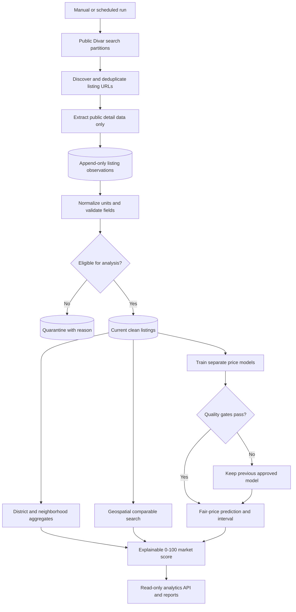

# Market Analytics and Listing Recommendation Service Plan

## 1. Goal

Add a third Node.js service that collects **public listing data only**, builds a historical market dataset, computes district and nearby-property statistics, trains price-regression models, and gives each eligible listing an explainable market score.

The service must never click the contact button, request a phone number, call the Divar contact endpoint, consume token-bot credentials, or depend on Telegram authentication.

“All ads” means all listings discoverable through the configured public search partitions during a bounded crawl. It cannot guarantee every listing on Divar because search pagination, ranking, removals, platform limits, and transient failures are outside the service's control.

## 2. Recommended service boundary

Create a third project:

```text
owj-market-analytics/
├── package.json
├── src/
│   ├── index.js                 Service entry point
│   ├── config.js                Collection, database, and model settings
│   ├── collector/               Public discovery and detail extraction
│   ├── cleaning/                Validation, units, deduplication, outliers
│   ├── storage/                 Database schema and repositories
│   ├── analytics/               District and nearby-comparable statistics
│   ├── models/                  Regression training, evaluation, prediction
│   ├── scoring/                 Explainable listing score
│   ├── api/                     Read-only results and health endpoints
│   └── jobs/                    Collect, aggregate, train, and score jobs
├── test/
└── data/                        Local database and model artifacts
```

The service may reuse pure public extraction and Persian-normalization functions from the root crawler. It must not import `src/crawler/contact.js`, `src/crawler/tokenClient.js`, or `src/utils/alerts.js`.

Before implementation, the reusable public functions should either:

- move into a small shared package, or
- be exposed through a contact-free adapter with dependency tests.

The shared-package approach is cleaner long-term. A small adapter is faster for the first pilot.

## 3. System flow



## 4. Separation from the authenticated crawler

| Concern | Existing crawler | New analytics service |
| --- | --- | --- |
| Primary goal | Full listing extraction, including authorized contact data | Market observation and valuation |
| Token bot | Used for authenticated contact requests | Never used |
| Contact button | May lead to contact extraction | Never clicked |
| Contact endpoint | Used with a throttled account token | Explicitly blocked |
| Data retention | Current per-listing JSON | Historical observations plus derived analytics |
| Crawl style | Target/latest/backfill run | Incremental public market snapshots |
| Output | Normalized listings | Statistics, comparables, predictions, scores |

The new collector should use a fresh non-authenticated browser context. It does not need `.browser-profile/` unless a persistent anonymous profile is operationally useful.

## 5. Data model

Version one uses JSON only. The canonical contract is `owj-market-analytics/schemas/public-listing.schema.json`. Each listing is written atomically to `data/listings/TOKEN.json`, its changed observations are appended to `data/observations/TOKEN.json`, and `data/listings.json` is a periodically refreshed combined checkpoint. This keeps live writes inspectable without rewriting one large document after every ad.

The following logical records are versioned JSON documents rather than database tables. A later NoSQL system can adopt the same document boundaries and schema versions.

### Crawl-run document

- `id`
- `started_at`, `ended_at`
- configured partitions and limits
- discovered, extracted, rejected, failed counts
- HTTP/platform warning counters
- service version and schema version

### Public-listing document

One current canonical document per Divar token:

- identity: token, canonical URL, category, subcategory
- time: first seen, last seen, published text, inactive timestamp
- location: city, district, neighborhood
- coordinates: latitude, longitude, accuracy/source
- property: area, construction year, rooms, floor, total floors
- amenities: elevator, parking, storage, balcony
- prices: sale price, price per square metre, deposit, rent
- advertiser class, but no contact fields
- clean-data status and exclusion reason
- content/repost fingerprint

### Listing-observation document

Append-only history for every successful public observation:

- listing token and crawl-run ID
- observed timestamp
- public property/location/price fields
- source-quality metadata
- raw normalized snapshot JSON

This history allows price-change analysis, listing age, delisting detection, and time-correct model training.

### District-metrics document

- period and transaction type
- city, district, neighborhood
- listing count
- mean, median, trimmed mean
- p25, p75, p90
- median price per square metre
- median area and days observed
- data-quality and sample-size flags

### Online-model document

- model ID/version
- target and feature schema
- training/test windows and row counts
- hyperparameters
- MAE, median absolute percentage error, log error, and R²
- segment metrics by district and property type
- residual quantiles for prediction intervals
- approved/rejected status and reason

### Listing-analysis response

- listing token, model ID, score version
- predicted price and lower/upper interval
- asking-price gap percentage
- nearby median and percentile
- component scores and final score
- comparable count, radius, confidence, and explanation JSON

## 6. Cleaning and eligibility pipeline

Cleaning order matters. Every rejected or modified value should retain a reason.

1. Canonicalize URLs and deduplicate exact tokens.
2. Normalize Persian/Arabic characters and digits.
3. Normalize all monetary fields to **toman** and record the unit explicitly.
4. Keep sale, long-term rental, and short-term rental datasets separate.
5. Validate area, rooms, construction year, floor, coordinates, and prices using bounded rules.
6. Recompute `pricePerMeter = price / area` when both inputs are valid; compare it to the advertised value and flag large disagreement.
7. Detect likely reposts using a conservative fingerprint of normalized title, rounded area, location, price band, and stable image identifiers. Never merge records merely because their titles match.
8. Keep an append-only original observation and a separate cleaned representation.
9. Flag—not silently delete—extreme values. Use robust quantiles within transaction type and district.
10. Exclude records from modeling when the target or core features are missing, while retaining them for coverage statistics.

### Initial sale-model eligibility

- sale listing subtype
- positive sale price
- area within configured valid range
- derived price per square metre is positive
- at least district or usable coordinates/neighborhood
- not a duplicate observation of the same token at the same time
- not marked as an extreme unit/parse error

Rental modeling should be a separate phase. Deposit and monthly rent must not be combined using an undocumented conversion rule. If an equivalent-rent formula is later used, its rate must be configurable, dated, and shown in every result.

## 7. District and neighborhood statistics

Do not report only an arithmetic average. Asking-price data is skewed and contains outliers.

For each transaction type, district, neighborhood, and reporting period, calculate:

- count
- mean price and mean price per square metre
- median price and median price per square metre
- 10% trimmed mean
- p25, p75, and p90
- interquartile range
- median area
- new-listing count and observed price changes

Publish district metrics only when the segment has at least 20 eligible observations. Below that threshold, fall back to a broader neighborhood/district/city segment and label the fallback.

The median price per square metre should be the primary displayed benchmark. The mean is still included for the requested “average,” but it should not drive scoring alone.

## 8. Nearby comparable listings

Nearby comparisons must match similar properties, not merely the closest coordinates.

### Comparable filters

- same transaction type
- compatible property subtype
- active or recently observed within a configurable window, initially 30 days
- area within ±20%, widened only when needed
- rooms within ±1 when known
- construction age band when known
- exclude the subject listing itself
- exclude suspected reposts of the subject listing

### Search strategy

1. If usable coordinates exist, search a 1 km radius.
2. Expand to 2 km and then 3 km until at least 15–20 comparables exist.
3. Never cross a configured maximum radius without labeling the fallback.
4. If coordinates are absent or marked approximate, use neighborhood, then district.
5. Weight comparables by distance, recency, area similarity, subtype, and feature similarity.

### Comparable output per listing

- comparable count and search radius/fallback level
- weighted median asking price
- weighted median price per square metre
- p25/p75 range
- subject price percentile
- highest total asking price nearby
- highest price per square metre nearby
- top five most similar listings with similarity reasons

The highest-priced nearby listing is descriptive context, not a fair-value estimate. It must not independently raise the recommendation score.

## 9. Regression design

### First model

Start with an explainable regularized linear regression (ridge regression) for sale listings.

Target:

```text
log(sale price per square metre)
```

Initial features:

- district and neighborhood categorical indicators
- latitude/longitude or a coarse spatial cell when coordinates are reliable
- log area
- rooms
- construction age
- floor and total floors
- elevator, parking, storage, balcony
- property subtype
- advertiser type
- observation month/week to capture market movement

Do not use phone data, advertiser identity, free-text descriptions, or personal attributes as model features.

### Why start with ridge regression

- coefficients and effects are inspectable
- regularization handles correlated property features
- behavior is easy to test
- it provides a trustworthy baseline before adding nonlinear models

After the baseline is stable, compare it with a nonlinear candidate such as gradient-boosted trees. A more complex model replaces the baseline only if it improves time-based holdout metrics and segment stability without unacceptable loss of explainability.

### Evaluation protocol

- Split training and test sets by time, never randomly only.
- Keep all observations/fingerprints of the same listing on one side of the split.
- Report MAE in toman per square metre, median absolute percentage error, log error, and R².
- Report metrics by district, subtype, and price band.
- Compare against two baselines: district median and neighborhood median.
- Produce a prediction interval from held-out residual quantiles.
- Train only after at least 1,000 eligible sale observations exist, with at least 200 in the holdout window.
- Do not approve a model that fails to beat the district-median baseline on the primary holdout metrics.

These sample thresholds are starting guardrails and should be raised as data volume grows.

## 10. Listing score

The score is a market-ranking aid, not a guarantee of value, saleability, legal condition, or investment return.

Only score listings with sufficient price, area, location, comparable, and model confidence. Otherwise return `insufficient-data` with explicit reasons.

### Proposed 0–100 score

| Component | Weight | Meaning |
| --- | ---: | --- |
| Model value gap | 35 | Asking price relative to predicted fair-price interval |
| Comparable value gap | 25 | Asking price relative to weighted nearby median |
| Local market position | 10 | Subject percentile inside its valid local segment |
| Confidence | 15 | Model interval width, comparable count, and location accuracy |
| Freshness/liquidity signals | 10 | Recency and segment activity; not inferred sale probability |
| Data completeness | 5 | Availability and consistency of core property attributes |

Penalties apply for contradictory prices, approximate/missing location, suspected reposts, stale observations, extreme outliers, or weak sample sizes.

### Required explanation per listing

```json
{
  "status": "scored",
  "score": 78,
  "askingPrice": 0,
  "predictedPrice": 0,
  "predictionInterval": { "low": 0, "high": 0 },
  "askingVsPredictionPct": 0,
  "nearbyMedianPricePerMeter": 0,
  "nearbyPricePercentile": 0,
  "highestNearbyAskingPrice": 0,
  "comparableCount": 0,
  "radiusMeters": 0,
  "confidence": "medium",
  "components": {},
  "warnings": []
}
```

Zeroes above are schema placeholders, not real estimates.

## 11. Read-only analytics API

Proposed endpoints:

| Method | Route | Purpose |
| --- | --- | --- |
| `GET` | `/health` | Crawl/database/model freshness and job status |
| `GET` | `/districts` | District metric summaries |
| `GET` | `/districts/:district` | Trends, distributions, and sample quality |
| `GET` | `/listings/:token/analysis` | Prediction, comparables, score, and explanation |
| `GET` | `/recommendations` | Filtered/ranked eligible listings |
| `GET` | `/models/current` | Approved model version and evaluation metrics |

The first implementation may write JSON reports before exposing HTTP endpoints. This reduces scope and lets the data/model design stabilize first.

## 12. Observation and safety guardrails

### Public-collection guardrails

- Never click contact, call, message, chat, or reveal-number controls.
- Block requests whose URL matches the Divar contact endpoint.
- Never import or request credentials from `owj-token-bot`.
- Use bounded concurrency and a configurable minimum request interval.
- Respect platform terms, robots guidance where applicable, and applicable law.
- On HTTP 429, CAPTCHA, repeated 403, or clear blocking signals: pause the crawl, record the event, and back off. Do not rotate identities or proxies to evade enforcement.
- Set per-run page, request, duration, and retry budgets.
- Identify partial crawl coverage honestly in every run report.

### Privacy guardrails

- Do not collect authenticated phone numbers or private contact data.
- Remove phone numbers and emails accidentally present in public descriptions before analytics storage.
- Do not expose exact coordinates through a public API; round or aggregate them.
- Do not use advertiser identity as a model feature.
- Keep raw HTML off by default; retain normalized observations and limited diagnostics.
- Apply retention limits to screenshots and rejected payload samples.

### Data-quality guardrails

- Version the schema, cleaning rules, score formula, and models.
- Never silently guess rial versus toman.
- Never mix sale and rental targets.
- Never mix total price and price per square metre.
- Never merge reposts without a conservative, explainable fingerprint.
- Record missingness and rejection rates by crawl run and district.
- Suppress segment statistics below the minimum sample size.
- Preserve original observations so cleaning changes can be audited.

### Model guardrails

- Use time-based validation and prevent listing/repost leakage.
- Compare against simple district/neighborhood baselines.
- Reject a new model when quality gates fail; keep the previous approved model.
- Do not publish a prediction without an uncertainty interval.
- Do not score listings outside the model's trained transaction/property scope.
- Monitor error and missingness by district to prevent misleading uneven quality.
- Do not describe scores as guaranteed bargains or investment advice.

### Observability guardrails

Every run should emit:

- discovered, visited, parsed, rejected, failed, and deduplicated counts
- public-detail request rate and latency
- status-code totals, 429/403/CAPTCHA counts, and backoff time
- field completeness by key and district
- price/unit anomaly counts
- coordinate accuracy/fallback distribution
- database write failures and queue depth
- model age, training size, holdout metrics, and prediction coverage
- scored versus `insufficient-data` counts and reasons

Alert conditions should include:

- contact-endpoint attempt greater than zero
- authenticated-token access attempt greater than zero
- 429, CAPTCHA, or repeated 403
- extraction success below 80% for a run
- core-field completeness dropping more than 10 percentage points from baseline
- model input drift or holdout error exceeding the approved threshold
- stale collection or model beyond configured service-level windows

## 13. Phased implementation plan

### Phase 0 — Confirm scope and contracts

- Agree that version one models sale listings only.
- Agree on service name and JSON document boundaries.
- Define “district” versus “neighborhood” reporting hierarchy.
- Define crawl schedule and maximum permitted request rate.
- Freeze the first analytics output schema.

Exit criterion: this plan and the open decisions are approved.

### Phase 1 — Public-only collector

- Add the third Node project and configuration validation.
- Create a contact-free detail extractor.
- Add network-level contact-endpoint blocking.
- Reuse search discovery and Persian normalization safely.
- Store crawl-run records and append-only observations.
- Add idempotency, retry budgets, and graceful shutdown.

Exit criterion: a pilot crawl stores public observations and proves zero contact/token-bot calls.

### Phase 2 — Data profiling and cleaning

- Implement typed schemas and rejection reasons.
- Add unit consistency and recomputed price-per-metre checks.
- Add conservative repost fingerprints.
- Generate completeness/outlier/coverage reports.
- Run a multi-day pilot and review district/location coverage.

Exit criterion: data-quality report meets agreed thresholds or documents required extraction fixes.

### Phase 3 — Descriptive analytics and comparables

- Implement district/neighborhood distributions.
- Implement coordinate and fallback comparable selection.
- Add similarity weights and comparable explanations.
- Test radius expansion, self-exclusion, and repost exclusion.
- Produce per-listing analysis JSON without a machine-learning score.

Exit criterion: sampled comparable sets are manually plausible and reproducible.

### Phase 4 — Regression baseline

- Build leakage-safe feature encoding.
- Train ridge regression after minimum sample thresholds are met.
- Implement time-based evaluation and baseline comparison.
- Store versioned model artifacts and metrics.
- Add prediction intervals and out-of-scope detection.

Exit criterion: approved model beats district/neighborhood median baselines and passes segment checks.

### Phase 5 — Explainable scoring

- Implement component scores and penalties.
- Calibrate weights on held-out historical observations.
- Return `insufficient-data` when confidence is weak.
- Generate human-readable Persian/English explanations.
- Review score distribution and extreme recommendations.

Exit criterion: every score is reproducible, versioned, and explainable from stored inputs.

### Phase 6 — API, scheduling, and operations

- Add read-only API/report endpoints.
- Schedule collection, aggregation, training, and scoring independently.
- Add health, freshness, drift, and failure alerts.
- Add backup, retention, migration, and recovery procedures.
- Document deployment; remove or replace the currently disconnected Docker design.

Exit criterion: unattended operation is observable and recovers safely from partial failures.

## 14. Open decisions before coding

1. Should version one cover only sale apartments, all sale residential listings, or sales plus rentals?
2. How frequently should the public market snapshot run: hourly, daily, or another cadence?
3. Which NoSQL system should eventually consume the approved JSON document schemas?
4. Is district/neighborhood data sufficient when coordinates are approximate, or should a licensed geocoding/boundary source be added later?
5. Who is the score for: internal analysts, agents, or end users? This changes explanation and risk requirements.

## 15. Current evidence and limitation

The existing normalized listing schema contains the main proposed features: price, price per square metre, area, rooms, construction year, floors, amenities, district, neighborhood, coordinates, subtype, advertiser type, and scrape time.

A one-listing public pilot now proves the live path from discovery through extraction, atomic JSON persistence, online analytics, and JSON HTTP responses. It also proved that public structured `city_persian` and `district_persian` fields need to participate in location normalization; that parser improvement is included. A one-row pilot cannot establish field completeness, district balance, price distributions, or model quality, so a larger observation period is still required before regression scores can be approved.
