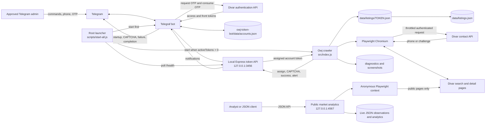
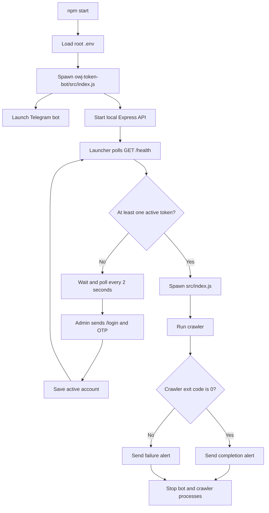
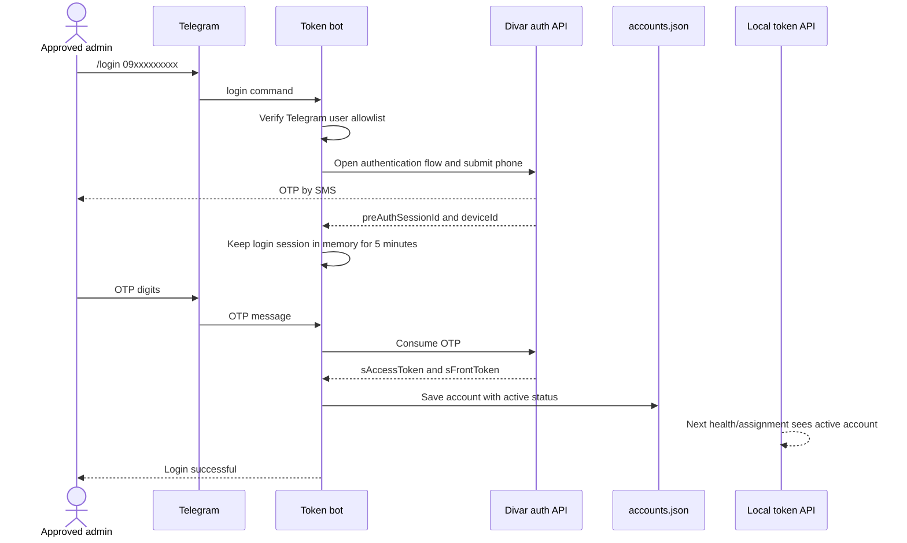
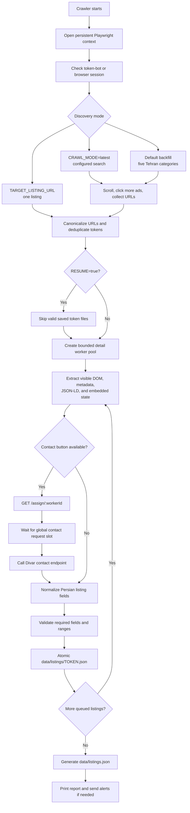
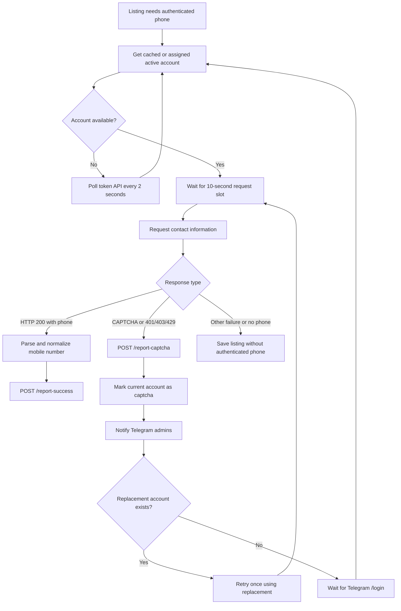

# Owj Crawler System Flow

## Purpose

This repository contains three Node.js applications:

1. **Owj Crawler** in the repository root discovers and extracts Divar real-estate listings.
2. **Owj Token Bot** in `owj-token-bot/` authenticates Divar accounts through Telegram OTP, stores their tokens, exposes a local token API, and sends operational alerts.
3. **Owj Market Analytics** in `owj-market-analytics/` independently crawls public listing data, stores live JSON observations, and serves district, comparable, regression, and score results as JSON. It never uses contact or token-bot functionality.

The authenticated crawler and token bot start together with `npm start`. The independent public analytics service starts with `npm run start:analytics`.

## High-level architecture



## Repository boundary

```text
owjcrawler/
├── package.json                    Root application scripts
├── scripts/start-all.js            Starts and supervises both processes
├── src/                            Crawler project
│   ├── index.js                    Crawl orchestration
│   ├── config.js                   Crawler/browser configuration
│   ├── crawler/
│   │   ├── browser.js              Persistent Chromium context
│   │   ├── search.js               Search discovery and scrolling
│   │   ├── backfill.js             Category-based discovery
│   │   ├── listing.js              Detail extraction
│   │   ├── contact.js              Phone requests and CAPTCHA flow
│   │   ├── tokenClient.js          Client for the local token API
│   │   └── session.js              Authentication-state reporting
│   ├── parsers/realEstate.js       Normalization and validation
│   ├── workers/detailWorkerPool.js Concurrent detail processing
│   ├── storage/listingFiles.js     Atomic JSON persistence
│   └── utils/alerts.js             Telegram alerts through token API
├── data/                           Generated crawler results
├── screenshots/                    Failure and search diagnostics
├── owj-market-analytics/           Public-only live JSON analytics service
│   ├── schemas/                    Canonical JSON collection/response schemas
│   ├── src/collector/              Anonymous discovery and public extraction
│   ├── src/analytics/              District and nearby calculations
│   ├── src/models/                 Online regression state
│   ├── src/storage/                Atomic JSON persistence
│   └── src/api/                    Read-only JSON server
└── owj-token-bot/                  Authentication and Telegram project
    ├── package.json
    ├── src/index.js                Telegraf and Express startup
    ├── src/bot/handlers.js         Telegram commands and OTP sessions
    ├── src/divar/apiLogin.js       Divar OTP authentication
    ├── src/divar/tokens.js         Account JSON persistence
    ├── src/api/server.js           Local token/alert API
    └── data/accounts.json          Stored credentials; never commit
```

## Complete startup flow



The launcher also handles `SIGINT` and `SIGTERM`. Pressing `Ctrl+C` stops both child processes.

## Telegram authentication flow



Only IDs in `ALLOWED_TELEGRAM_USERS` may use bot handlers. The bot supports `/login`, `/accounts`, `/delete`, and `/cancel`.

## Crawler pipeline



The detail pool can process several pages concurrently, but all phone requests in the crawler process share one contact-request schedule. With the current default, contact requests begin at least 10 seconds apart.

## Contact and CAPTCHA recovery



`src/crawler/contact.js` uses a process-wide pause gate while account replacement or login is pending. Other contact workers wait behind that gate and resume when a usable account is available.

## Local token API contract

The bot's Express server binds to `127.0.0.1:3456` by default.

| Method | Route | Called by | Purpose |
| --- | --- | --- | --- |
| `GET` | `/health` | Launcher | Check service readiness and active-token count |
| `GET` | `/tokens` | Operator/client | Return all active account records |
| `GET` | `/assign/:workerId` | Crawler | Reuse or assign the least-used active account |
| `POST` | `/report-captcha` | Crawler | Disable challenged account, alert admins, return replacement |
| `POST` | `/report-success` | Crawler | Mark the current account active |
| `POST` | `/alert` | Launcher/crawler | Forward an operational message to Telegram |

The crawler communicates with the bot only through this HTTP API. It does not read `owj-token-bot/data/accounts.json` directly.

## Important runtime data

| Location | Owner | Contents |
| --- | --- | --- |
| `owj-token-bot/data/accounts.json` | Token bot | Divar access/front tokens, device IDs, phone, login time, status |
| Token API assignment map | Token bot memory | `workerId` to account-phone assignment |
| Telegram OTP session map | Token bot memory | Telegram-user login session, expiring after five minutes |
| Token-client cache | Crawler memory | Assigned account, refreshed after 30 minutes |
| Contact schedule and CAPTCHA gate | Crawler memory | Request spacing and process-wide pause state |
| `data/discovered-listings.json` | Crawler | Incremental URL-discovery checkpoint |
| `data/search-diagnostics.json` | Crawler | Search iterations, partitions, and sanitized network records |
| `data/listings/TOKEN.json` | Crawler | One validated, normalized listing |
| `data/listings.json` | Crawler | Combined listing export |

## Configuration ownership

Root `.env` configures the launcher and crawler:

```dotenv
TOKEN_API_URL=http://127.0.0.1:3456
WORKER_ID=worker-standalone
MAX_LISTINGS=100
DETAIL_CONCURRENCY=3
CONTACT_REQUEST_INTERVAL_MS=10000
```

`owj-token-bot/.env` configures Telegram, account storage, and the local API:

```dotenv
TELEGRAM_BOT_TOKEN=replace_me
ALLOWED_TELEGRAM_USERS=replace_me
ACCOUNTS_FILE=./data/accounts.json
API_HOST=127.0.0.1
API_PORT=3456
```

Both environment files and the account store contain secrets and must remain uncommitted.

## Commands

| Command | Behavior |
| --- | --- |
| `npm start` | Start the bot/API, wait for login, then start the crawler |
| `npm run start:bot` | Start only the token bot and local API |
| `npm run start:crawler` | Start only the crawler; token API must already be available |
| `npm --prefix owj-token-bot run dev` | Start the bot using Node watch mode |
| `npm test` | Run the root Node test suite |

## Current implementation notes

1. `DETAIL_CONCURRENCY` creates several browser detail workers, but `WORKER_ID` is process-wide. Therefore, one crawler process normally receives one token assignment shared by all its detail workers.
2. Contact throttling is also process-wide. Multiple detail workers cannot send contact requests back-to-back.
3. Token assignments are held in memory and disappear when the bot restarts. Accounts remain in `accounts.json`.
4. The token API exposes live tokens and has no API authentication. Keep it bound to loopback unless transport authentication and network restrictions are added.
5. Account-file updates are plain read/modify/write operations without locking or atomic rename.
6. The persistent `.browser-profile/` can contain cookies and browsing history and should be treated as sensitive runtime state.
7. `docker-compose.yml` describes Redis, proxies, and multiple workers, but that design is not connected to the current code and no Dockerfile exists. The supported current architecture is the local two-process launcher documented above.

## Quick operational checklist

1. Install dependencies in both Node projects.
2. Install Playwright Chromium.
3. Configure both `.env` files.
4. Keep the token API on `127.0.0.1`.
5. Run `npm start`.
6. If prompted, authenticate through Telegram using `/login` and the SMS OTP.
7. Monitor Telegram for CAPTCHA and crawler alerts.
8. Inspect `data/listings.json` after successful completion.
